# mujoco-viser-usage

MuJoCo robots in the browser, rendered with [Viser](https://github.com/nerfstudio-project/viser).
Interactive scenes, contact-driven demos, a PPO control room, and a native
[mjlab](https://github.com/mujocolab/mjlab) (MuJoCo-Warp) backend.

**[Project page](https://joonhyung-lee.github.io/mujoco-viser-usage/)** ·
[Architecture](docs/architecture.md) · [mjlab](docs/mjlab.md) · [RL](docs/rl.md)

<p align="center">
  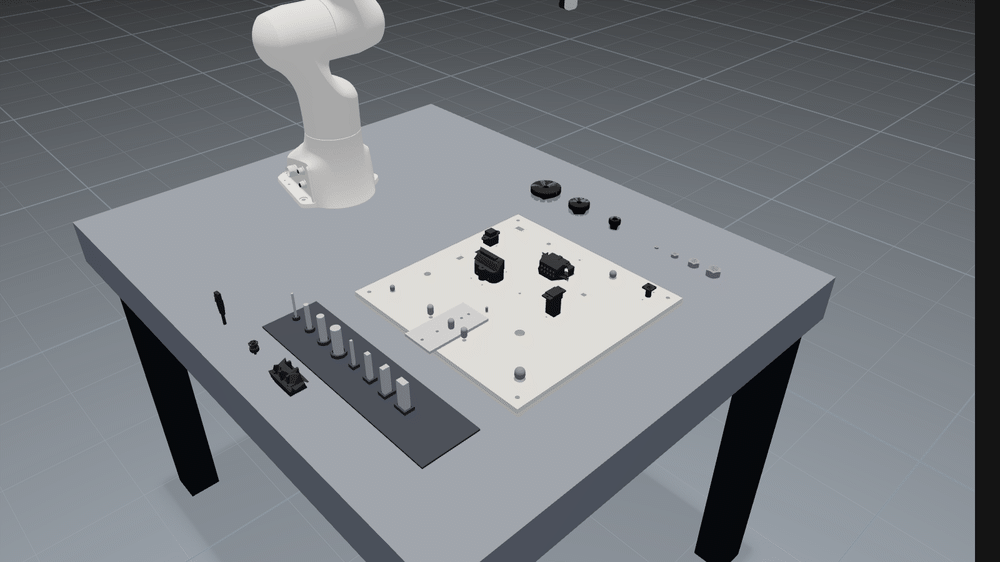
</p>
<p align="center">NIST Assembly Task Board #1 · scripted assembly, 6× speed</p>

## Quick start

Python ≥ 3.12 and [uv](https://docs.astral.sh/uv/).

```bash
uv sync
uv run mujoco-viser-usage                            # UR5e pick & place → http://127.0.0.1:8080
uv run mujoco-viser-usage --list
uv run mujoco-viser-usage manipulation/nist_board --demo
```

```python
from mujoco_viser_usage import ViserParser

with ViserParser(viewer=False) as robot:
    robot.set_control("shoulder_pan", -1.3)
    robot.step(nstep=500)
    q = robot.get_q()
```

## Scenes

| | Robots | Demo |
| --- | --- | --- |
| Manipulation | UR5e + RG2, Franka, ALOHA | Pick & place through contact only |
| Franka tasks | `franka_plug`, `franka_cable` | 2.5 mm plug insertion, cable-end routing |
| NIST board | `nist_board` | Assembly Task Board #1 from the NIST STL kit |
| Locomotion | Go1, Go2, Spot, Spot + arm | Analytic trot on position servos |
| Navigation | Husky, TurtleBot3 | BFS path following in a maze |

Go2 and Husky also come on `ramps`, `steps`, `rough`, and `mixed` terrain.
Overlays: contact-force arrows, wrist RGB, tracked end-effector path.

<table>
  <tr>
    <td>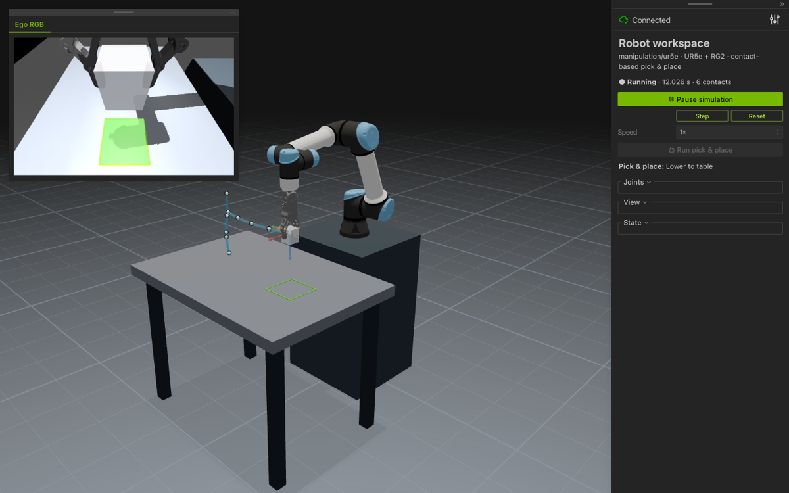</td>
    <td>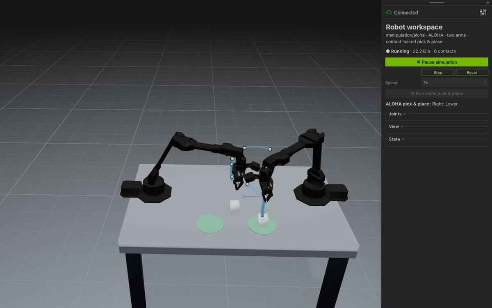</td>
  </tr>
  <tr>
    <td align="center">UR5e + RG2 · pick & place, wrist RGB, contact forces</td>
    <td align="center">ALOHA · bimanual pick & place</td>
  </tr>
  <tr>
    <td>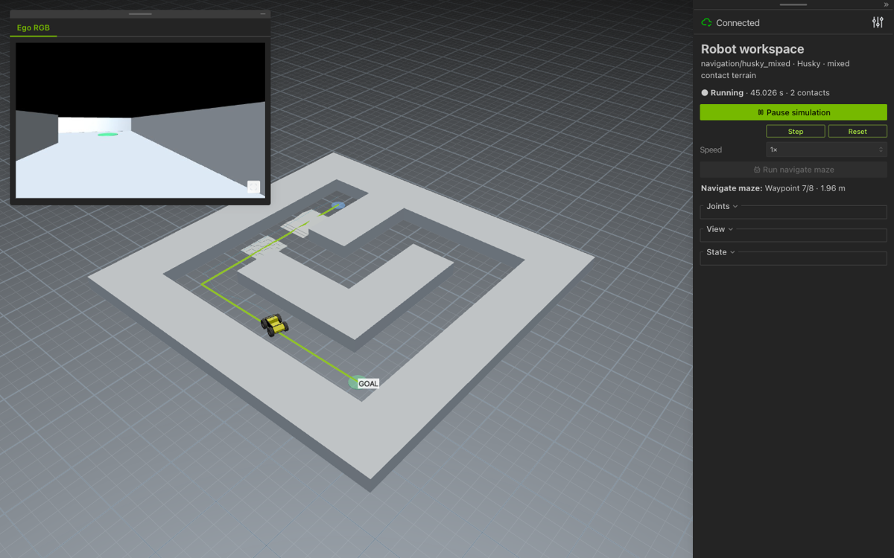</td>
    <td>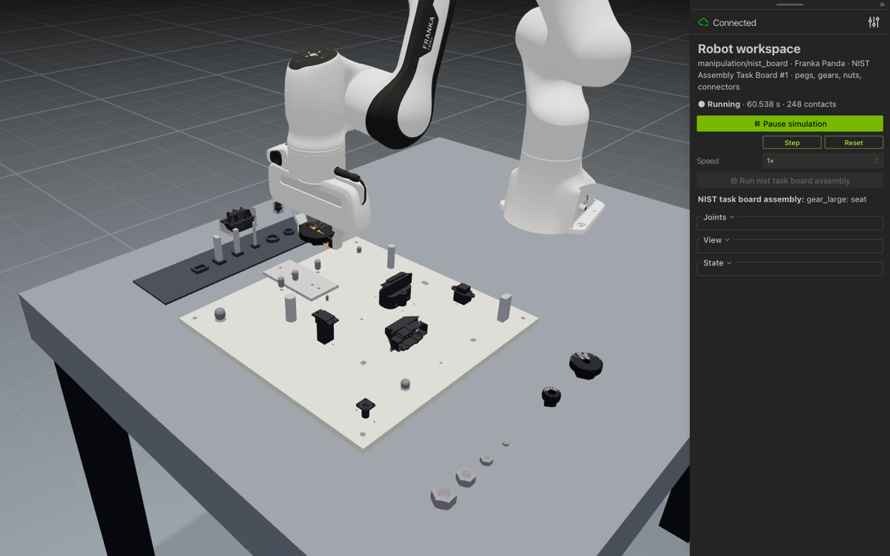</td>
  </tr>
  <tr>
    <td align="center">Husky · maze, mixed terrain</td>
    <td align="center">NIST board · viewer</td>
  </tr>
  <tr>
    <td>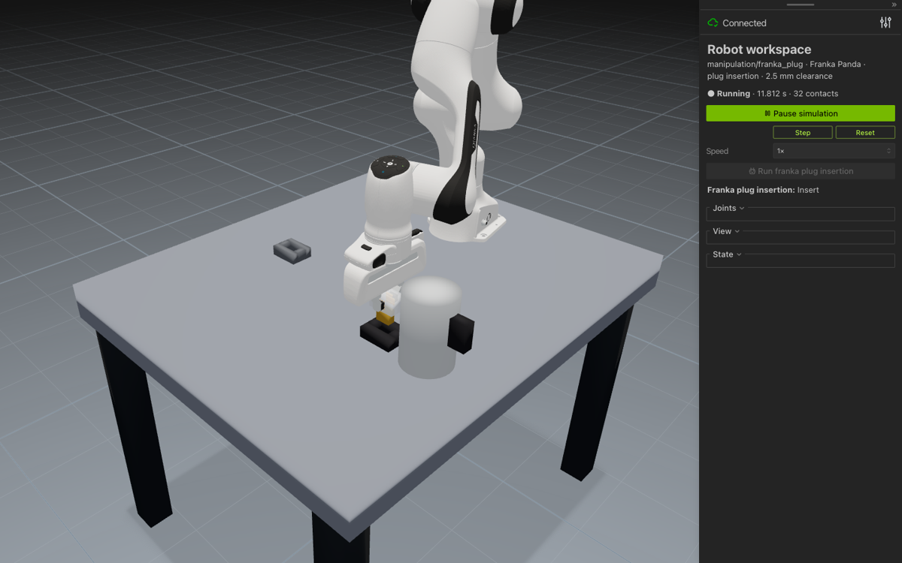</td>
    <td>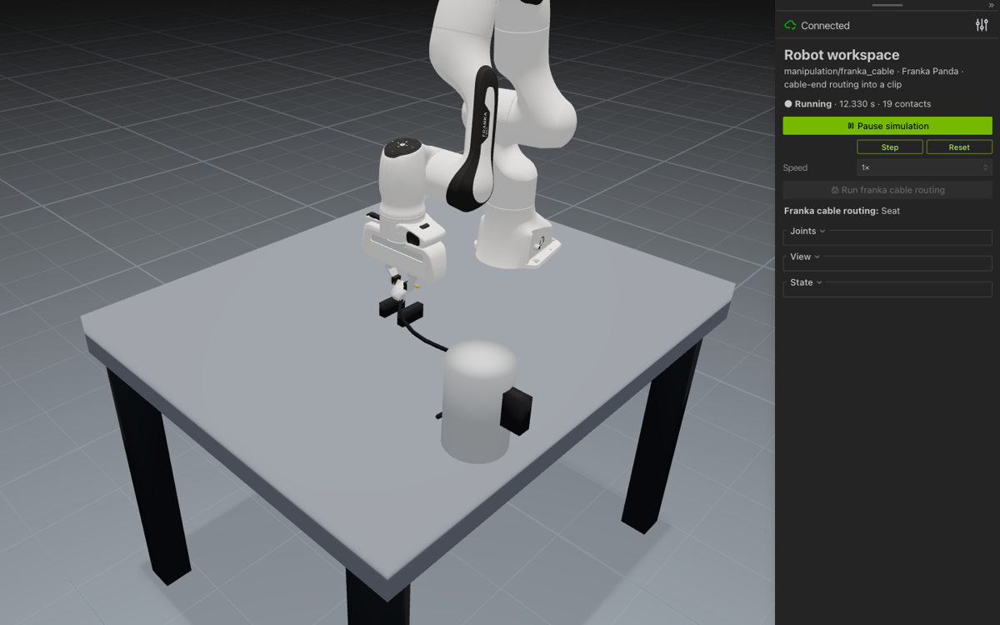</td>
  </tr>
  <tr>
    <td align="center">Franka · plug insertion</td>
    <td align="center">Franka · cable routing</td>
  </tr>
</table>

### NIST Assembly Task Board #1

Built from the public NIST STL kit. Hole positions are measured from the laser-cut plate,
diameters and 45° lead-ins follow the NIST instructions. MuJoCo collides meshes as convex
hulls, so holes, bores, and nuts are primitive rings; pegs pass through 0.1–0.25 mm
clearances for real. The scripted run seats a 16 mm rod, 16 mm peg, 12 mm rod, the large
gear, and an M16 nut within 1 mm (the AlphaNIST criterion). Connector mating is not modeled.

## RL

```bash
uv sync --extra rl
uv run --extra rl mujoco-viser-rl --port 8090
uv run --extra rl mujoco-viser-train --config assets/rl/franka_insert.json
```

Tasks: `franka_insert`, `aloha_reach`, `aloha_pick_place`, `go2_velocity`.
PPO over parallel MuJoCo workers; pause, stop, resume from checkpoints; buffered 1× replay.

<p align="center">
  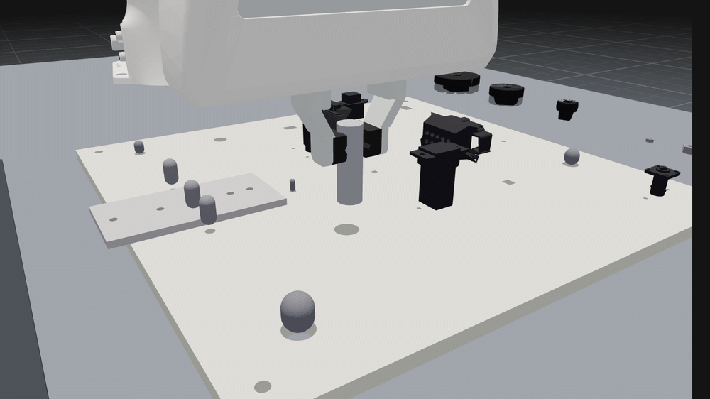
</p>
<p align="center"><code>franka_insert</code> · PPO policy, three held-out seeds, real time</p>

`franka_insert` starts with a NIST peg already grasped above its hole. Hole (±5 mm) and
in-hand (±3 mm, ±5° for square pegs) offsets are hidden; the policy sees proprioception,
the nominal goal, and the wrench on the part, and outputs 25 Hz TCP deltas. Success is the
AlphaNIST criterion, part within 1 mm of its seated pose. Ten held-out seeds:

| Part | Straight down | PPO | Steps |
| --- | --- | --- | --- |
| `rod_16` (⌀16 mm, 0.25 mm clearance) | 6/10 | 10/10 | 0.58M |
| `peg_16` (16×10 mm, ±5° in-hand yaw) | 7/10 | 8/10 | 1.0M |

Going straight down succeeds only where the 3 mm chamfer absorbs the offset. The square peg
also has to be rotated into its pocket; the run above had not converged at 1M steps
(rolling success 0.69 and still rising), so treat its row as a lower bound.

<table>
  <tr>
    <td>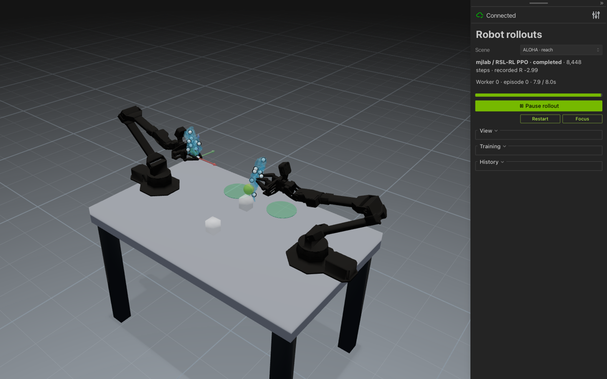</td>
    <td>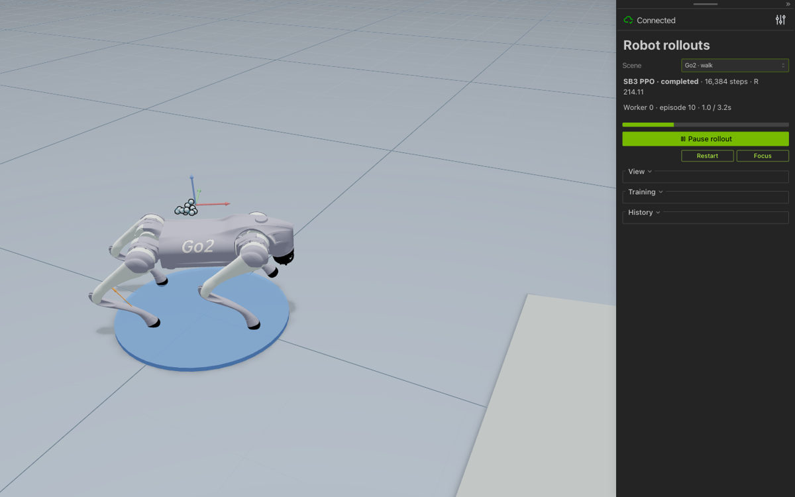</td>
  </tr>
  <tr>
    <td align="center">ALOHA reach · mjlab / RSL-RL</td>
    <td align="center">Go2 velocity · SB3</td>
  </tr>
</table>

## mjlab backend

Same tasks on MuJoCo-Warp with RSL-RL. Optional extra; pulls torch and pins MuJoCo 3.11.

```bash
uv sync --extra mjlab
uv run --extra mjlab python -m mujoco_viser_usage.mjlab train \
  Viser-Go2-Velocity-v0 --gpu-ids '[0]' --env.scene.num-envs 512
uv run --extra mjlab python -m mujoco_viser_usage.mjlab.evaluate <run-dir>
uv run python -m mujoco_viser_usage.rl.comparison runs/<comparison-dir>
```

Tasks: `Viser-Aloha-{Reach,Lift,Place,Bimanual}-v0`, `Viser-Go2-Velocity-v0`.
Evaluation replays the scripted controller and the policy on the same seed, side by side.

<table>
  <tr>
    <td>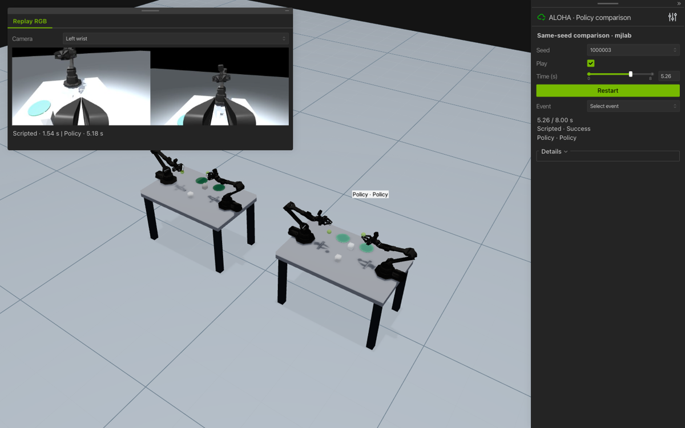</td>
    <td>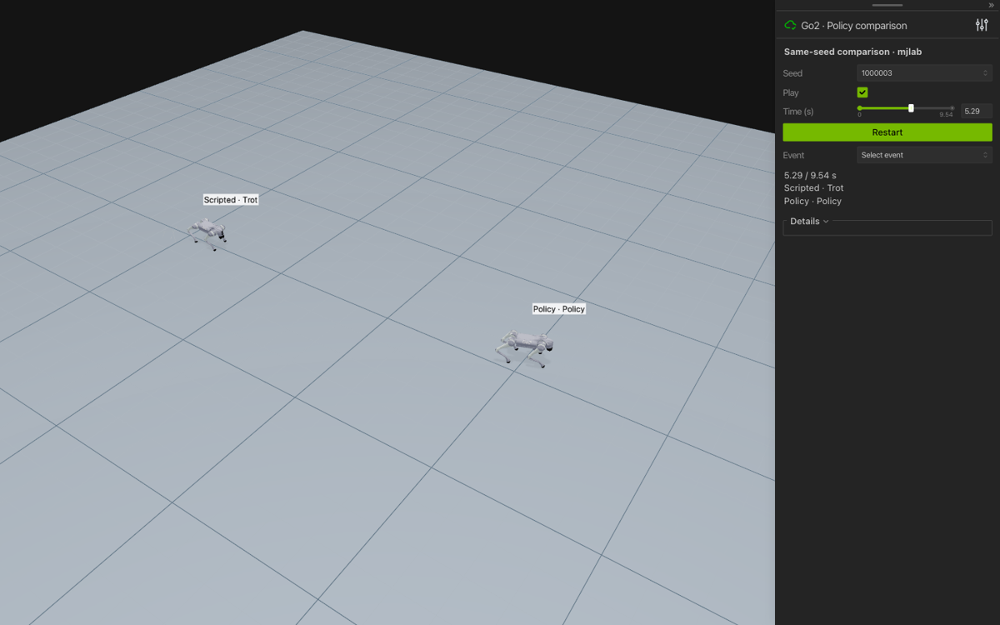</td>
  </tr>
  <tr>
    <td align="center">ALOHA · scripted vs policy</td>
    <td align="center">Go2 · scripted vs policy</td>
  </tr>
</table>

## Layout

```text
assets/               MJCF + meshes (manipulation/ locomotion/ navigation/), RL configs
docs/                 project page, architecture, mjlab, RL notes
mujoco_viser_usage/   viewer, simulation, scenes, rl/, mjlab/, tools/
notebooks/            runnable examples
tests/
```

```bash
uv run pytest -q
uv run ruff check .
```

Robot models from [MuJoCo Menagerie](https://github.com/google-deepmind/mujoco_menagerie)
and related sources; see [THIRD_PARTY.md](THIRD_PARTY.md).
